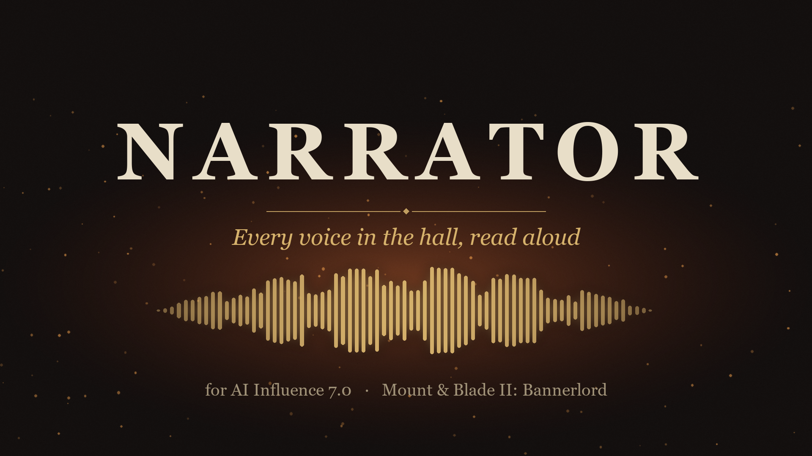

# Narrator – Voices for AI Influence



A companion tool for the **AI Influence** mod (7.x) for *Mount & Blade II: Bannerlord*.
It reads AI Influence conversations aloud: a steady narrator voice for the
`*actions*`, and every character in their own voice, performed with the delivery
note the mod's AI writes for each line. Voices come from the **Player2** app
running on the same PC.

It is **not** a game module: nothing goes into the game's `Modules` folder and no
game file is replaced. It is a small Python program that runs beside the game.

The full player guide is [`README.txt`](README.txt) (it ships inside the release zip).

---

## What is in this repository

| File | What it is |
|---|---|
| `NARRATOR.py` | The narrator: watches the mod's files and log, asks Player2 for audio, plays it. Start here when reading the code. |
| `TTS_NARRATOR.py` | Shared parts: finding the AI Influence install and campaign, the voice table, name pronunciations, reading the mod's files. |
| `MEMORY_BOOK_HOOK.py` | Adds a small script to AI Influence's Memory Book page so the narrator knows which page is open (see below). |
| `START_NARRATOR.bat` | Windows launcher: finds Python 3.10+, installs the requirements once, starts `NARRATOR.py`. |
| `requirements.txt` | The four Python packages it needs. |
| `pronunciations.txt` | Starter file where players add their own pronunciations. |
| `README.txt` | The player guide that ships in the zip. |
| `build.py` | Builds the release zip (see *Building*). |
| `make_art.py`, `art/` | Makes the two Nexus images. Not part of the release. |

All of it is plain, readable Python source. There are no compiled files, no
bundled executables and nothing downloaded at run time apart from the four
Python packages below, which `pip` installs from PyPI.

## Requirements

- Windows 10 or 11
- Mount & Blade II: Bannerlord with **AI Influence 7.x**
- The **Player2** app, running and signed in – <https://player2.game>
- **Python 3.10 or newer** – <https://www.python.org/downloads/>
- Python packages (installed automatically on first start, or by hand):
  `requests`, `flask`, `pystray`, `pillow` – see `requirements.txt`

## Running from source

```
git clone https://github.com/Retiredemo/Narrator.git
cd Narrator
py -m pip install -r requirements.txt
py NARRATOR.py
```

or simply double-click `START_NARRATOR.bat`, which does the same.

## Building

Nothing is compiled. "Building" the release only copies the seven files a
player needs into one zip, after checking that none of them contains anything
from the author's machine:

```
py build.py
```

This writes `dist/Narrator-AIInfluence-1.0.0.zip`, which is the file uploaded
to Nexus Mods. It needs only the Python standard library.

## What it touches on your PC

It **reads**:
- AI Influence's campaign files under `Modules\AIInfluence\save_data\<campaign>\`
  (character files, letters, world events, the Memory Book) and the mod's log
  `Modules\AIInfluence\logs\mod_log.txt`;
- AI Influence's MCM settings file (for its TTS volume and speed sliders).

It **writes** only:
- its own files in its own folder (`proxy_config.txt`, `npc_voices.json`,
  `narrator_log.txt`, speed/volume/banned-voice settings);
- **one line** in the campaign's `prompts\json_output\JsonOutputExpressionField.txt`,
  asking the mod's AI for its per-line voice note (`tts_instructions`). AI Influence
  7.1 only asks for that note while its own TTS is on, and it must be off here, or
  every line is spoken twice. Set `ASK_MOD_FOR_NOTES = False` in `NARRATOR.py` to
  turn this off;
- **a small script** added to `Modules\AIInfluence\MemoryBook\wwwroot\index.html`,
  so the Memory Book hotkey reads the page you have open. The original is kept
  beside it as `index.html.before-narrator`.

## Network

It talks **only to this computer**:
- the Player2 app's local API at `http://127.0.0.1:4315` (text-to-speech, and its
  AI for a delivery note when the mod's is missing);
- a tiny local web server on `127.0.0.1` (ports 4401–4405) that the Memory Book
  page reports the open page to, and port 4399 so only one copy runs at a time.

(The older proxy mode in `TTS_NARRATOR.py` also listens on `127.0.0.2:4315`,
which is this computer too.) It never contacts any other server, sends no
telemetry and needs no API keys.

## Licence

Open source under the [MIT licence](LICENSE): read it, change it, reuse it.
AI Influence, Player2 and Mount & Blade II: Bannerlord belong to their own
authors; this repository contains none of their files.
